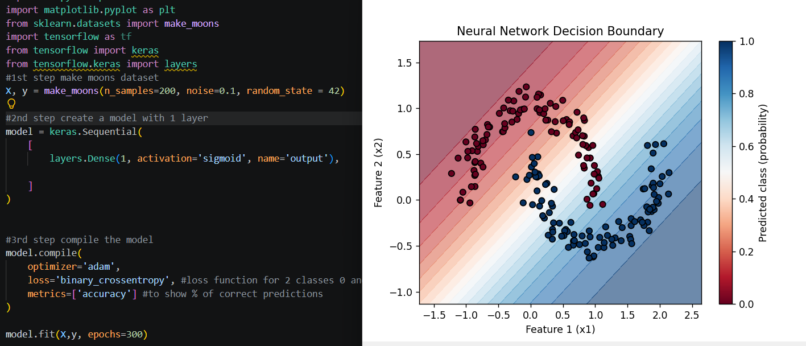
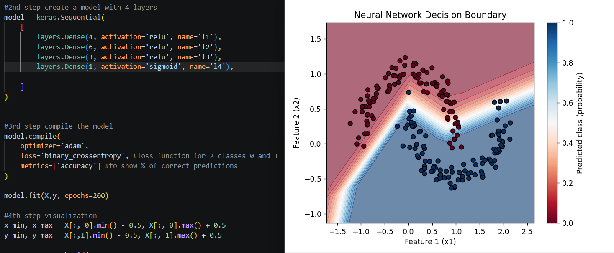
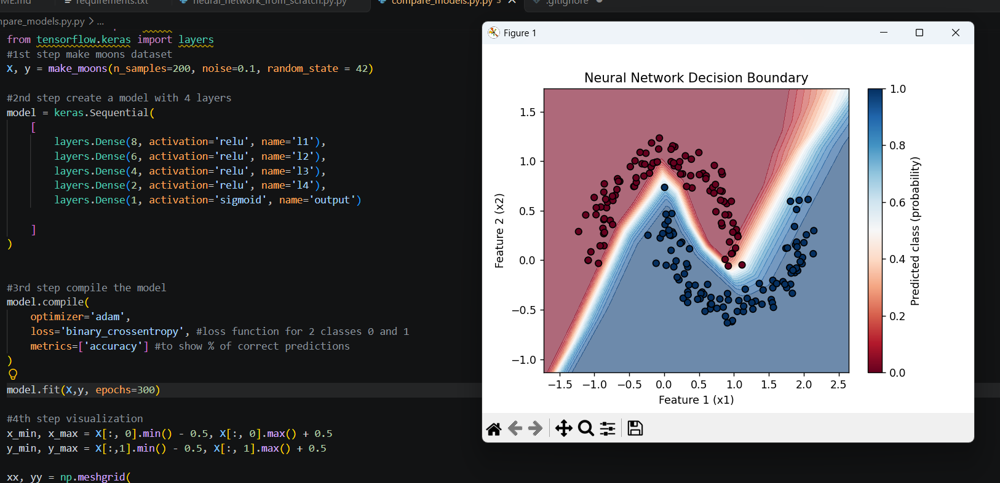

# Neural Network: From Scratch to TensorFlow/Keras

This project shows my step-by-step journey into neural networks. It starts with a simple single-neuron model (Logistic Regression) written in Python from scratch using only `numpy`, and then moves on to multi-layer neural networks built with TensorFlow/Keras to solve non-linear problems.

## Project Overview

The repository contains two main parts:

1. **From Scratch (`neural_network_from_scratch.py`):**
   A single-neuron network trained on a basic linear binary classification problem. It creates a random dataset of 2D points $(x_1, x_2)$ and divides them into two groups using the rule:
   $Y = 1$ **if** $x_1 + x_2 > 0$**, else** $Y = 0$
   The model learns to draw a straight line to separate these two groups without using any ML frameworks.

2. **Non-Linear Data & Multi-Layer Network (`1_neuron.py` & `compare_models.py`):**
   To see why hidden layers are needed, I switched to the non-linear `make_moons` dataset (two interlocking half-circles) from `scikit-learn`.
   * `1_neuron.py` runs a single neuron with `sigmoid` activation on `make_moons`. Because it can only draw a straight line, it cannot separate the two moons cleanly.
   * `compare_models.py` builds a multi-layer `Sequential` model in Keras with `ReLU` hidden layers. This allows the network to bend the decision boundary and accurately separate the data.

## Main Features of this Project

* **From-Scratch Math (`neural_network_from_scratch.py`):** Manual implementation of forward propagation ($Z = W \cdot X + b$ with Sigmoid), Binary Cross-Entropy loss (with `1e-15` to avoid log-of-zero errors), backward propagation ($dZ$, $dW$, $db$), and Gradient Descent.
* **Non-Linear Dataset Generation:** Uses `make_moons(n_samples=200, noise=0.1, random_state=42)` to create a dataset that a straight line cannot separate.
* **Keras `Sequential` Models:** Compares a 1-layer model against 4-layer and 5-layer networks trained with the `Adam` optimizer.
* **Decision Boundary Visualization:** Uses `matplotlib` (`contourf` and `scatter`) to show the probability zones, decision boundary, and data points.

## Built With

* **Python 3**
* **NumPy** (for math and matrix operations)
* **Matplotlib** (for drawing graphs and decision boundaries)
* **scikit-learn** (for generating the `make_moons` dataset)
* **TensorFlow / Keras** (for building and training multi-layer neural networks)

## Experiments & Results (`make_moons`)

To find a good architecture for the `make_moons` dataset, I tested different numbers of layers, neurons, and epochs:

| Model / Script | Architecture | Epochs | Result |
| :--- | :--- | :---: | :--- |
| `1_neuron.py` | 1 layer (`1` neuron, Sigmoid) | 300 | Draws a straight line; misclassifies points where the moons overlap. |
| `compare_models.py` (v1) | 4 layers (`4 -> 6 -> 3 -> 1`) | 200 | Accuracy ~92.5%, loss ~0.27. Boundary bends, but is still too angular. |
| `compare_models.py` (final) | 5 layers (`8 -> 6 -> 4 -> 2 -> 1`) | 300 | Smooth S-shaped boundary that cleanly separates the two moons. |

### Visual Comparison

**1 Layer (`1_neuron.py`) — Linear Boundary:**


**4 Layers (`4 -> 6 -> 3 -> 1`, 200 epochs) — First Non-Linear Attempt:**


**5 Layers (`8 -> 6 -> 4 -> 2 -> 1`, 300 epochs) — Final Model:**


## How to Run the Project

1. Clone this repository:

   ```bash
   git clone https://github.com/Sonicbum/neural-network-from-scratch.git
   ```

2. Install the required dependencies:

   ```bash
   pip install -r requirements.txt
   ```

3. Run any of the scripts:

   ```bash
   # Original single neuron from scratch
   python neural_network_from_scratch.py

   # Single neuron on make_moons (Keras)
   python 1_neuron.py

   # Multi-layer neural network on make_moons (Keras)
   python compare_models.py
   ```

## What You Will See

* **`neural_network_from_scratch.py`** prints predictions for new test data and opens a Matplotlib window with Red/Blue points separated by a dashed black line.
* **`1_neuron.py`** and **`compare_models.py`** print the training progress (`accuracy` and `loss`) for each epoch and open a Matplotlib window showing the `make_moons` points, the colored probability zones, and the decision boundary.